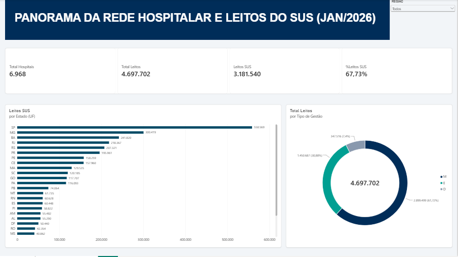
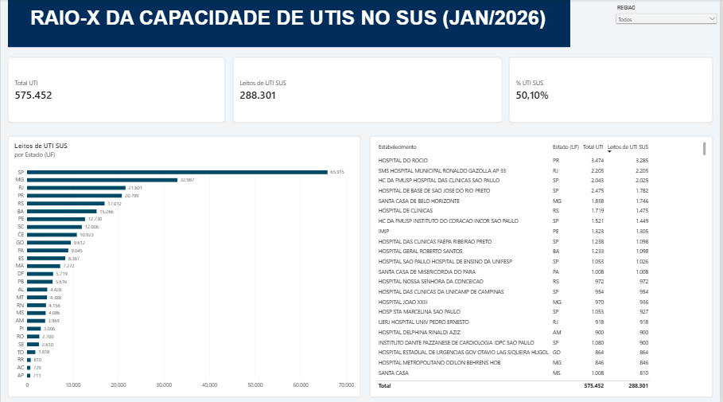

# 🏥 Panorama da Rede Hospitalar e Capacidade de UTIs no SUS (Jan/2026)

Dashboard executivo desenvolvido no **Power BI Desktop** para análise da infraestrutura hospitalar brasileira, comparando a disponibilidade de leitos gerais e de alta complexidade (UTI) entre o Sistema Único de Saúde (SUS) e a rede privada/suplementar.

---

## 📊 Visão Geral do Projeto

### 1. Panorama da Rede Hospitalar e Leitos Gerais


### 2. Raio-X da Capacidade de UTIs


---

## 💡 Principais Insights de Negócio

* **Ampla cobertura pública nos leitos gerais:** O Brasil conta com **6.968 estabelecimentos hospitalares** e **4.697.702 leitos totais**, dos quais **3.181.540 (67,73%)** são destinados ao SUS.
* **Equilíbrio público-privado na alta complexidade:** Quando o recorte passa para leitos de terapia intensiva (**575.452 UTIs totais**), a participação do SUS cai para **50,10% (288.301 leitos)**, evidenciando o peso da rede privada/suplementar na infraestrutura crítica.
* **Concentração regional e liderança estadual:** São Paulo lidera com folga a oferta absoluta tanto em leitos gerais SUS (**558.569**) quanto em leitos de UTI SUS (**65.915**), seguido por Minas Gerais e Rio de Janeiro.
* **Perfil de gestão:** A gestão **Municipal** concentra **61,72%** dos leitos totais do país, seguida pela gestão **Estadual (30,88%)** e **Dupla (7,40%)**.

---

## 🛠️ Ferramentas e Técnicas Aplicadas

* **Power BI Desktop:** Modelagem, construção de layout executivo em duas páginas (`Visão Geral` e `Capacidade UTI`), hierarquia visual e segmentação dinâmica por Região.
* **Linguagem DAX:** Criação de medidas explícitas para agregação e cálculo de participação percentual (`SUM`, `DIVIDE`, `DISTINCTCOUNT`).
* **Data Storytelling & UI/UX:** Aplicação de paleta institucional da saúde, contraste entre fundo neutro (`#F3F5F8`) e cartões elevados (`#FFFFFF`), e padronização numérica sem abreviações.

---

## 🧮 Principais Medidas DAX Utilizadas

```dax
Total Leitos = SUM(Leitos_2026[LEITOS_EXIST])
Leitos SUS = SUM(Leitos_2026[LEITOS_SUS])
% Leitos SUS = DIVIDE([Leitos SUS], [Total Leitos], 0)

Total UTI = SUM(Leitos_2026[UTI_TOTAL_EXIST])
UTI SUS = SUM(Leitos_2026[UTI_TOTAL_SUS])
% UTI SUS = DIVIDE([UTI SUS], [Total UTI], 0)
